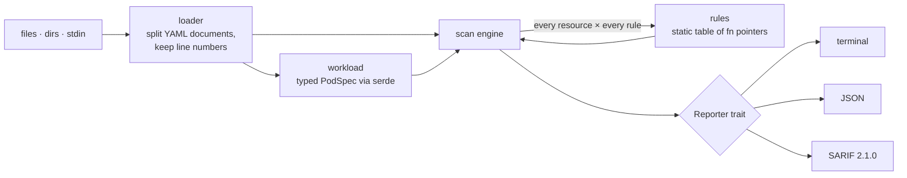

# kubesieve

[](https://github.com/zaremifa-cell/kubesieve/actions/workflows/ci.yml)

**A fast, static security scanner for Kubernetes manifests, written in Rust.**

kubesieve reads your YAML — plain files, whole directories, or the output of `helm template` / `kustomize build` — and reports configurations that make a cluster easier to attack: privileged containers, root users, host mounts, secrets committed in plain text, over-broad RBAC, unencrypted ingress. It runs in milliseconds, needs no cluster access, and plugs into CI through exit codes and SARIF.

```console
$ kubesieve scan examples/insecure
examples/insecure/app.yaml:2  Deployment shop/payments-api
  CRITICAL KS001  Privileged container
             container "api" runs privileged
             at spec.template.spec.containers[0].securityContext.privileged
             fix Remove `privileged: true` and grant only the specific capabilities the process needs.
  HIGH     KS010  Secret in plain environment variable
             env var "DB_PASSWORD" holds a literal value that looks like a secret (value redacted)
             at spec.template.spec.containers[0].env[0].value
             fix Store the value in a Secret and reference it with `valueFrom.secretKeyRef`.
  …

31 findings (4 critical, 10 high, 12 medium, 5 low) · 7 resources in 3 files
```

## Install

```sh
cargo install --git https://github.com/zaremifa-cell/kubesieve
# or
docker build -t kubesieve . && docker run --rm -v "$PWD:/work:ro" kubesieve scan .
```

Pre-built binaries for Linux (static musl), macOS and Windows are attached to every [release](https://github.com/zaremifa-cell/kubesieve/releases).

## Usage

```sh
kubesieve scan deploy/                        # scan a directory recursively
kubesieve scan app.yaml rbac.yaml             # specific files
helm template ./chart | kubesieve scan -      # rendered Helm chart from stdin
kustomize build overlays/prod | kubesieve scan -

kubesieve scan . --format json                # machine-readable report
kubesieve scan . --format sarif -o out.sarif  # for GitHub code scanning
kubesieve scan . --fail-on critical           # only block the build on critical issues
kubesieve scan . --min-severity medium        # hide low/info findings
kubesieve scan . --skip KS013,KS015           # disable rules for this run
kubesieve rules                               # list every rule
```

**Exit codes** make it a drop-in CI gate:

| Code | Meaning |
|------|---------|
| `0`  | No finding at or above `--fail-on` (default `high`) |
| `1`  | At least one finding at or above `--fail-on` |
| `2`  | The input could not be read (missing file, invalid YAML, malformed pod spec) |

### Suppressing a finding

Some workloads legitimately need what is normally dangerous — a node log collector needs `hostPath`. Annotate the resource instead of disabling the rule everywhere:

```yaml
metadata:
  annotations:
    kubesieve.io/ignore: "KS004, KS005"   # or "all"
```

Suppressed findings are still counted in the summary, so silenced risk stays visible in review.

## Rules

| ID | Severity | Rule |
|----|----------|------|
| KS001 | critical | Privileged container |
| KS002 | high | Privilege escalation allowed |
| KS003 | high | Container may run as root (container settings override pod settings) |
| KS004 | high | Host network / PID / IPC namespace shared |
| KS005 | high → critical | hostPath volume (critical for `/`, `/etc`, container runtime sockets…) |
| KS006 | high | Dangerous capability added (`SYS_ADMIN`, `NET_ADMIN`, `SYS_PTRACE`…) |
| KS007 | medium | Default capabilities not dropped |
| KS008 | medium | Writable root filesystem |
| KS009 | medium | No seccomp profile, or `Unconfined` |
| KS010 | high → critical | Secret in plain environment variable (AWS keys are critical; values are never printed) |
| KS011 | low | Service account token auto-mounted |
| KS012 | medium | Mutable image tag (`:latest` or untagged) |
| KS013 | info | Image not pinned by digest |
| KS014 | medium | No memory limit |
| KS015 | low | No CPU / memory requests |
| KS101 | high → critical | Wildcard RBAC permissions |
| KS102 | critical | Binding to `cluster-admin` |
| KS103 | medium | Read access to Secrets |
| KS201 | low | Service exposed via NodePort / LoadBalancer without source ranges |
| KS202 | medium | Ingress without TLS |

Workload rules understand `Pod`, `Deployment`, `StatefulSet`, `DaemonSet`, `ReplicaSet`, `ReplicationController`, `Job`, `CronJob` and `PodTemplate`, including init and ephemeral containers. `kind: List` documents are expanded.

## CI integration

GitHub Actions, with results shown as code-scanning alerts on pull requests:

```yaml
- run: cargo install --git https://github.com/zaremifa-cell/kubesieve
- run: kubesieve scan k8s/ --format sarif --output kubesieve.sarif --no-fail
- uses: github/codeql-action/upload-sarif@v3
  with: { sarif_file: kubesieve.sarif }
- run: kubesieve scan k8s/ --fail-on high   # then gate the merge
```

This repository does exactly that on itself — see [`.github/workflows/ci.yml`](.github/workflows/ci.yml): formatting, Clippy with warnings as errors, tests on Linux/macOS/Windows, an MSRV check, a Docker build, and a SARIF upload of the scan of `examples/`.

## Design



A few decisions worth calling out:

- **Rules are data.** Each rule is a `Rule` struct holding its metadata and a plain `fn` pointer, collected in one `static RULES: &[Rule]` table. Adding a rule is one function plus one table entry; there is no runtime registration and no allocation. An `Emitter` fills in file, line, resource and rule metadata, so a check only states *where* and *what*.
- **Typed where it matters, untyped where it doesn't.** The pod spec is deserialized into Rust structs (`serde`, every field optional/defaulted, unknown fields ignored) so the workload rules are checked by the compiler. Simple one-field checks on Services and Ingresses read the raw YAML tree.
- **Kubernetes semantics, not string matching.** Container `securityContext` overrides the pod's, exactly as the kubelet does; `registry:5000/app` is recognised as a port, not a tag; `runAsUser: 1000` satisfies the non-root rule even without `runAsNonRoot`.
- **Errors don't hide findings.** Documents are split by hand so each keeps its starting line; a broken document produces an error (exit code 2) while every other document is still scanned.
- **Safe by construction.** No `unsafe`, no network access, and secret values are never echoed into reports, logs or SARIF.
- **Stable fingerprints.** SARIF results carry an FNV-1a fingerprint of rule + resource + field path, so GitHub tracks the same alert across commits. (`std`'s `DefaultHasher` is deliberately not used: its output may change between Rust releases.)

## Development

```sh
cargo test                                   # 30 unit + integration tests
cargo clippy --all-targets -- -D warnings
cargo fmt --check
```

Integration tests in [`tests/cli.rs`](tests/cli.rs) run the real binary: exit codes, stdin, file output, JSON summary arithmetic, SARIF rule indices.

## Limitations

- Reports point to the line where a resource starts, not the exact field line (the field is given as a path such as `spec.template.spec.containers[0].image`).
- Kustomize patches and Helm templates should be scanned after rendering (`kustomize build` / `helm template`), since partial patches do not describe the final object.
- The YAML parser is `serde_yaml` 0.9, which is no longer maintained; the loader is isolated in one module so the parser can be swapped.

## License

MIT
